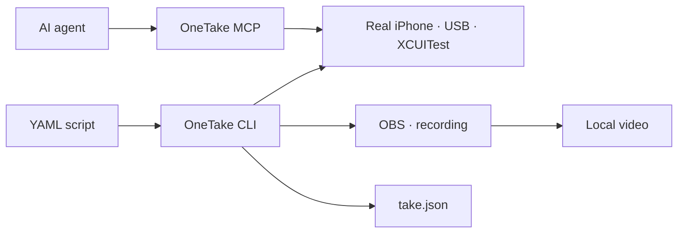

# OneTake

### Repeatable iPhone demos.

**Write your script in YAML. Control a real iPhone. Record with OBS.**

OneTake combines XCUITest automation, recording and human checkpoints for developers who need to demonstrate an app without manually repeating every tap. The CLI runs your scripts; the MCP server lets an AI agent inspect the interface and help prepare the demonstration.

[Installation](docs/installation.md) · [Your first demo](docs/usage.md) · [Contributing](CONTRIBUTING.md)

> **Experimental — source-only installation, licensed under MIT.** Intended for developers with a Mac and a physical iPhone. This is not an App Store application, the project does not maintain a public npm package, and initial setup requires Xcode and Apple development signing.

## What is it for?

- **Product demos:** reuse scenes, selectors and checks in a version-controlled script.
- **QA and review evidence:** record a real execution, with step results in `take.json`.
- **AI-assisted preparation:** read the accessibility tree, inspect the screen and test targets through MCP.
- **Human-in-the-loop workflows:** pause when login, Face ID or another decision requires the person responsible.

The app being demonstrated does not need to integrate a OneTake SDK. It remains separate from the host app and test runner installed by Xcode.



## Try it without connecting an iPhone

Install [Node with nvm](https://github.com/nvm-sh/nvm#installing-and-updating), then:

```sh
git clone https://github.com/anboia/onetake.git
cd onetake
nvm install
nvm use
npm ci
./bin/onetake --help
./bin/onetake take validate examples/first-take.choreo.yaml --json
```

These commands install dependencies, display help and validate an example **without controlling a device or opening OBS**. While the repository is private, cloning requires access granted by its owner.

To run and record a demo, follow the [full installation guide](docs/installation.md) and adapt the [annotated example](examples/first-take.choreo.yaml) to your app. The example is a template, not an application bundled with the project.

> **Warning:** `take run --dry` performs real actions on the iPhone; it only disables OBS recording. To check the file without operating a device, use `take validate`.

## Current capabilities

| Interface | Available |
| --- | --- |
| CLI | Build, start and stop the runner; inspect status; configure OBS; validate, execute and control takes |
| MCP | `doctor`, `device_status`, `screenshot`, `ui_tree`, `tap` |
| Scripts | YAML scenes, accessibility/OCR/coordinate targets, conditions, checkpoints and partial execution |
| Recording | OBS through obs-websocket v5, local output and execution records |
| Development | TypeScript tests, strict types and Swift tests without a device |

**Know what is not yet integrated:** MCP does not start recordings; there is no complete, one-command public post-production workflow; Android, Windows and Linux are not supported operating platforms. The specification in `spec/` includes planned work and historical decisions, not a list of shipped features. See [status and limitations](docs/status.md).

## Recording requirements

- A Mac; the initial setup targets Apple Silicon and the documented Homebrew paths.
- Node **22.x, starting at 22.18**; the launcher rejects other major versions.
- Xcode with the iOS 26 SDK, XcodeGen and an existing Apple Development signing identity.
- A physical iPhone running iOS 26.x, with Developer Mode enabled, trust established with the Mac and a USB cable.
- OBS with obs-websocket v5, ffmpeg/ffprobe and available disk space.

See the [reference versions and compatibility limits](docs/installation.md). A newer version does not establish compatibility with the runner.

## Working with AI agents

The repository provides these complementary entry points:

- [Development guide](docs/development.md): commands, architecture and contracts for agents that modify the code. Creation of `AGENTS.md` and `CLAUDE.md` is pending write approval.
- [MCP configuration](.mcp.json): stdio client integration through the `bin/onetake-mcp` launcher. The detailed `docs/agents.md` guide is also pending write approval in the editing environment.
- [`llms.txt`](llms.txt): a compact documentation index for context-retrieval tools.

The server advertises its tool schemas through the protocol itself. Agents can discover the actual interface rather than rely on a guessed API or a copy of the entire specification in a prompt.

## Contributing

Start with the [contribution guide](CONTRIBUTING.md). Documentation fixes, generic examples, selector tests and compatibility reports are useful first contributions. Discuss major changes before implementing them.

- [Architecture and testing](docs/development.md)
- [Code of conduct](CODE_OF_CONDUCT.md)
- [Security and privacy](SECURITY.md)
- [Publication checklist](docs/publishing.md)

**Never include personal videos, credentials, certificates, real UDIDs or your machine configuration in a pull request.**

## Naming and compatibility

OneTake is the public name of the project previously called Contrarregra. The new commands are `onetake` and `onetake-mcp`; legacy launchers remain available. Some Swift module names, protocol identifiers and the Keychain service stay unchanged to preserve existing installations and files. See [migration](docs/migration.md).

Public documentation and contribution templates are maintained in English. Historical specifications, research, experiment reports and internal handoffs retain their original language; they are not the current onboarding documentation.

## License

[MIT](LICENSE). You may use, modify and redistribute the code under the license terms, retaining the required notices. Dependencies retain their own licenses. `private: true` in the package manifest prevents accidental npm publication; it does not determine GitHub visibility or restrict the MIT license. Publishing recordings and personal data requires separate permission. See the [publication checklist](docs/publishing.md).
