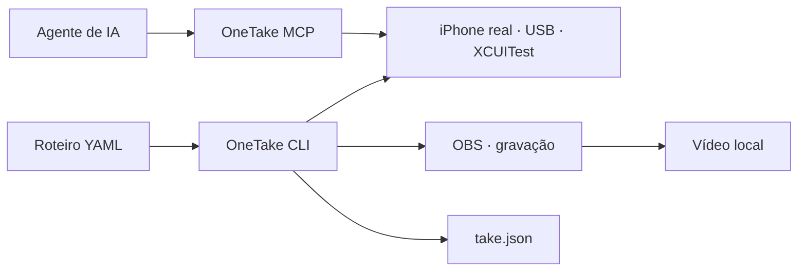

# OneTake

[English](README.md) · **Português (Brasil)**

### Demonstrações de iPhone que você pode repetir.

**Descreva o roteiro em YAML. Opere um iPhone real. Grave com o OBS.**

OneTake combina automação por XCUITest, gravação e pontos de intervenção humana para quem precisa demonstrar um aplicativo sem repetir manualmente cada toque. A CLI executa os roteiros; o servidor MCP permite que um agente de IA inspecione a interface e ajude a preparar a demonstração.

[Instalação](docs/installation.md) · [Primeira demonstração](docs/usage.md) · [Contribuir](CONTRIBUTING.md)

> Esta é a versão em português do [README principal](README.md). Os guias detalhados e os templates de contribuição continuam em inglês. Ao alterar o README, mantenha as duas versões sincronizadas.

> **Experimental — instalação a partir do código-fonte, sob licença MIT.** Destinado a desenvolvedores com um Mac e um iPhone físico. Não é um aplicativo da App Store, não há pacote npm público mantido por este projeto e a configuração inicial exige Xcode e assinatura Apple.

## Para que serve?

- **Demos de produto:** reutilize cenas, seletores e verificações em um roteiro versionado.
- **Evidências de QA e revisão:** registre uma execução real, com os resultados dos passos em `take.json`.
- **Preparação assistida por IA:** leia a árvore de acessibilidade, veja a tela e teste alvos via MCP.
- **Fluxos com intervenção humana:** pause quando login, Face ID ou outra decisão exigir a pessoa responsável.

O aplicativo demonstrado não precisa integrar um SDK do OneTake. Ele continua separado do aplicativo hospedeiro e do runner de testes instalados pelo Xcode.



## Experimente sem conectar um iPhone

Instale [Node com nvm](https://github.com/nvm-sh/nvm#installing-and-updating), depois:

```sh
git clone https://github.com/anboia/onetake.git
cd onetake
nvm install
nvm use
npm ci
./bin/onetake --help
./bin/onetake take validate examples/first-take.choreo.yaml --json
```

Esses comandos instalam as dependências, mostram a ajuda e validam um exemplo **sem operar o aparelho nem abrir o OBS**. Enquanto o repositório for privado, o clone exige acesso concedido pelo titular.

Para executar e gravar, siga a [instalação completa](docs/installation.md) e adapte o [exemplo comentado](examples/first-take.choreo.yaml) ao seu app. O exemplo é um modelo, não um aplicativo incluído no projeto.

> **Atenção:** `take run --dry` executa ações reais no iPhone; apenas não grava no OBS. Para conferir somente o arquivo, use `take validate`.

## O que funciona hoje

| Interface | Disponível |
| --- | --- |
| CLI | Construir, iniciar e parar o runner; consultar estado; configurar OBS; validar, executar e controlar tomadas |
| MCP | `doctor`, `device_status`, `screenshot`, `ui_tree`, `tap` |
| Roteiros | Cenas YAML, alvos de acessibilidade/OCR/coordenadas, condições, checkpoints e seleção de trechos |
| Gravação | OBS via obs-websocket v5, saída local e registro da execução |
| Desenvolvimento | Testes TypeScript, tipos estritos e testes Swift sem aparelho |

**Saiba o que ainda não está integrado:** o MCP não inicia gravações; não há um fluxo público completo de pós-produção com um único comando; Android, Windows e Linux não são plataformas de operação. A especificação em `spec/` contém trabalho futuro e decisões históricas, não uma lista de funcionalidades já entregues. Veja [estado e limitações](docs/status.md).

## Requisitos para gravar

- Mac, inicialmente com Apple Silicon e ferramentas Homebrew nos caminhos documentados.
- Node **22.x, a partir de 22.18**; outros majors são recusados pelo launcher.
- Xcode com SDK iOS 26, XcodeGen e identidade Apple Development já configurada.
- iPhone físico com iOS 26.x, Modo de Desenvolvedor, confiança no Mac e cabo USB.
- OBS com obs-websocket v5, ffmpeg/ffprobe e espaço em disco.

Veja as [versões de referência e os limites de compatibilidade](docs/installation.md). Ter uma versão mais recente não comprova compatibilidade com o runner.

## Usar com agentes de IA

O repositório inclui estas entradas complementares:

- [Guia de desenvolvimento](docs/development.md): comandos, arquitetura e contratos para agentes que modificam o código. A criação de `AGENTS.md` e `CLAUDE.md` aguarda autorização de escrita.
- [Configuração MCP](.mcp.json): integração stdio do cliente, com o launcher `bin/onetake-mcp`. O guia detalhado `docs/agents.md` também aguarda liberação de escrita no ambiente de edição.
- [`llms.txt`](llms.txt): índice enxuto da documentação para ferramentas de recuperação de contexto.

O servidor anuncia os schemas das ferramentas no próprio protocolo. O agente pode descobrir a interface real, em vez de depender de uma API presumida ou de uma cópia de toda a especificação no prompt.

## Colabore

Comece pelo [guia de contribuição](CONTRIBUTING.md). Correções na documentação, exemplos genéricos, testes de seletores e relatos de compatibilidade são boas primeiras contribuições. Discuta mudanças grandes antes de implementá-las.

- [Arquitetura e testes](docs/development.md)
- [Código de conduta](CODE_OF_CONDUCT.md)
- [Segurança e privacidade](SECURITY.md)
- [Preparação da publicação](docs/publishing.md)

**Nunca envie vídeos pessoais, credenciais, certificados, UDIDs reais ou configurações da sua máquina em um pull request.**

## Nome e compatibilidade

OneTake é o nome público do projeto anteriormente chamado Contrarregra. Os comandos novos são `onetake` e `onetake-mcp`; os launchers antigos continuam disponíveis. Alguns nomes de módulos Swift, identificadores de protocolo e o serviço do Chaveiro permanecem estáveis para não invalidar instalações e arquivos existentes. Consulte [migração](docs/migration.md).

A documentação pública e os templates de contribuição são mantidos em inglês, com este README também disponível em português. Especificações históricas, pesquisas, relatórios de experimentos e notas internas mantêm seu idioma original; não são os guias atuais de primeiros passos.

## Licença

[MIT](LICENSE). Você pode usar, modificar e redistribuir o código conforme os termos da licença, preservando os avisos exigidos. Dependências mantêm suas próprias licenças. `private: true` no manifesto impede publicação acidental no npm; não define a visibilidade no GitHub nem restringe a licença MIT. Publicação de gravações e dados pessoais exige autorização separada. [Checklist de publicação](docs/publishing.md).
